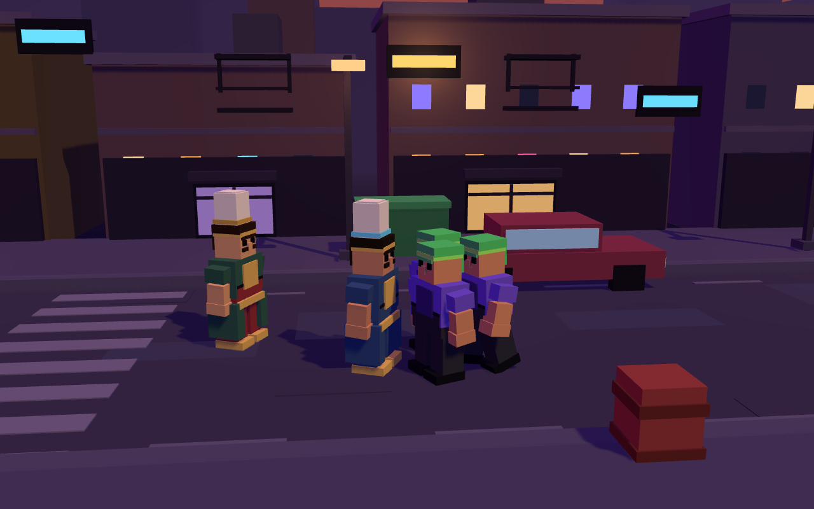
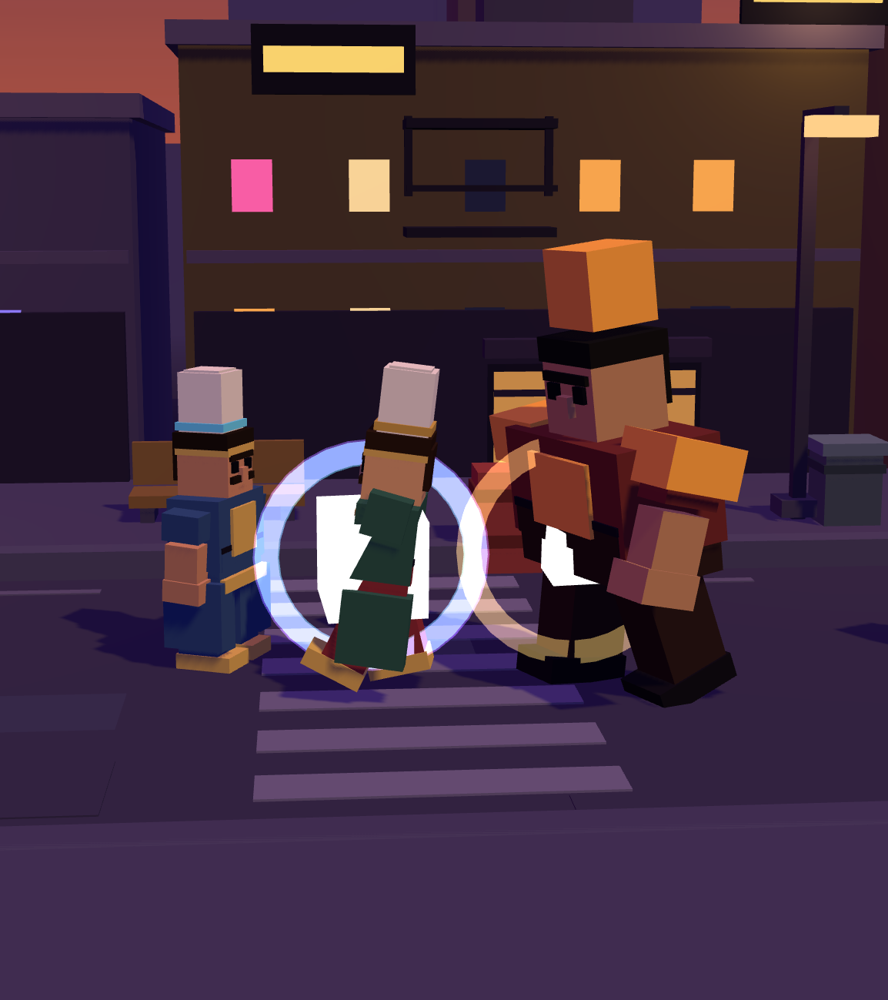
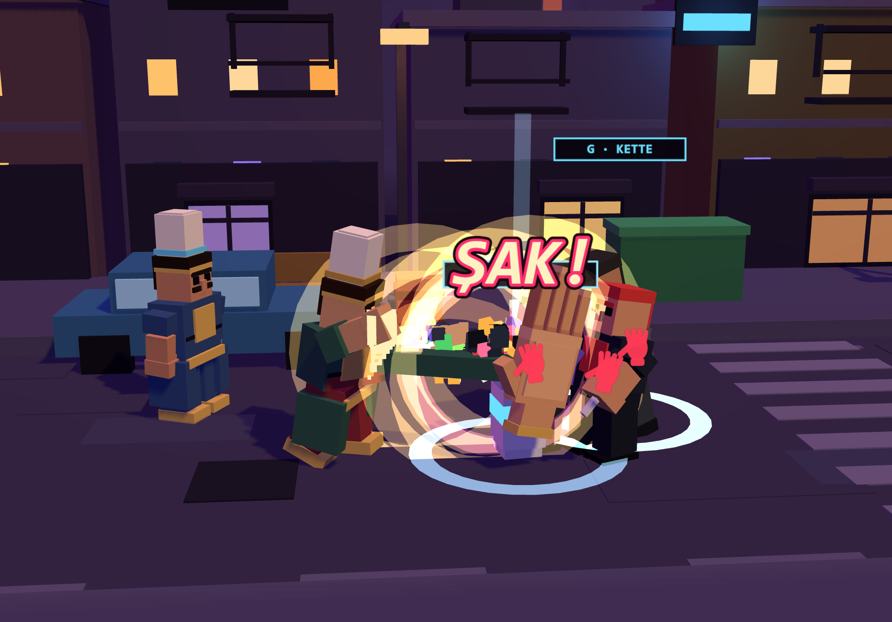
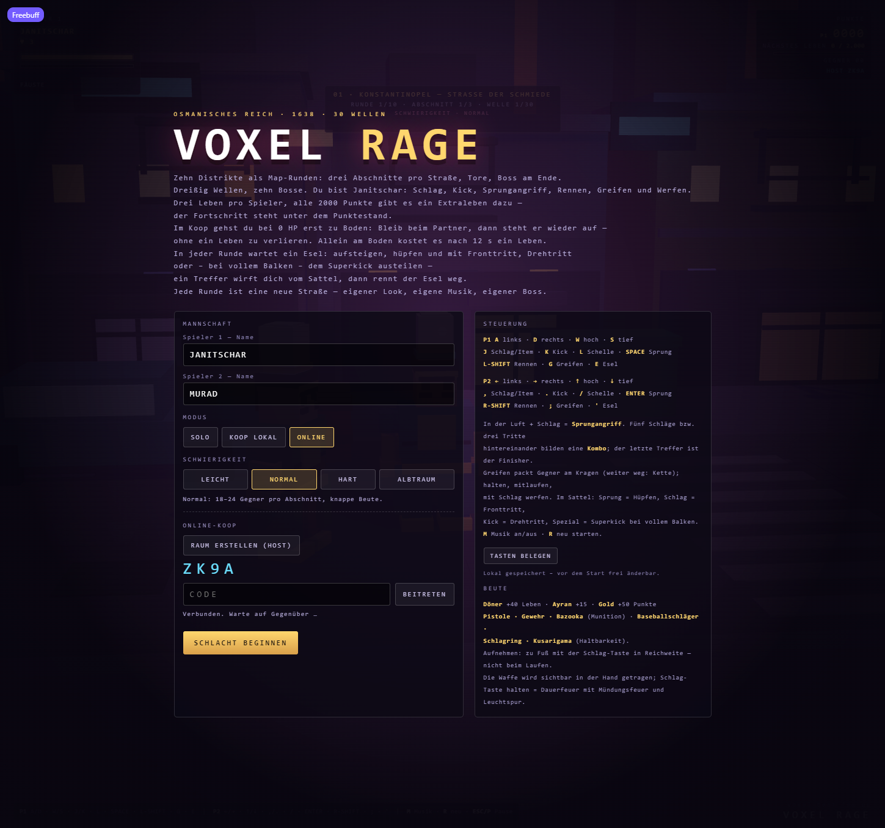
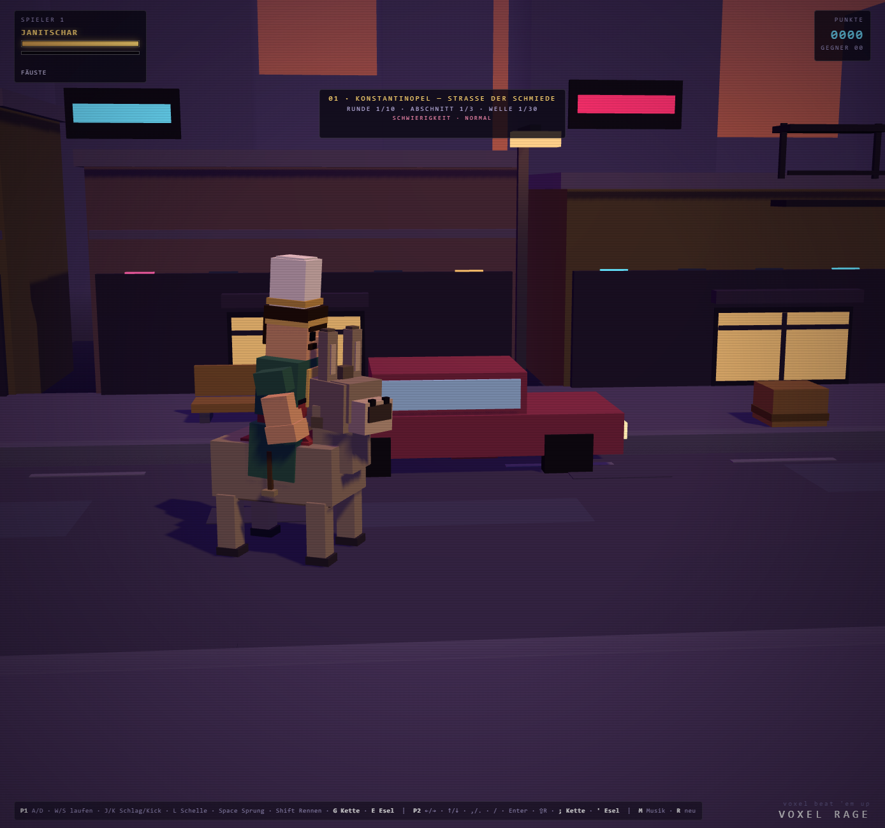
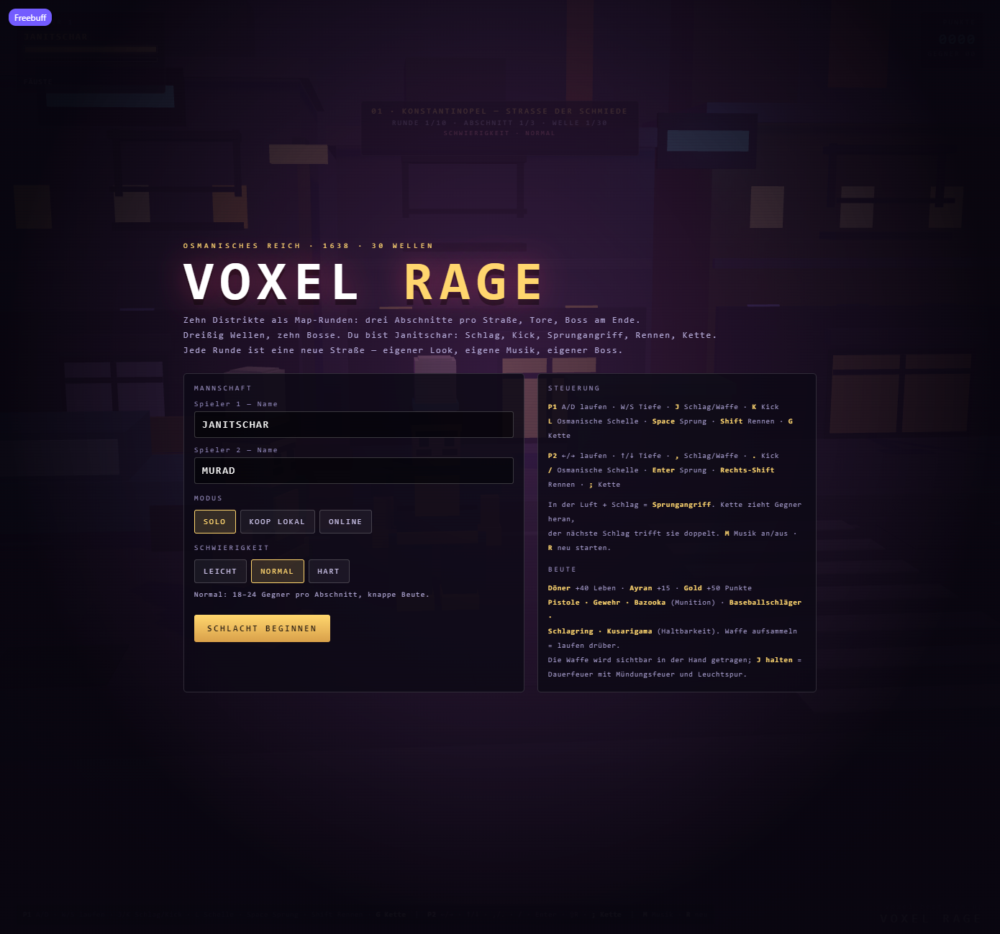

# VOXEL RAGE — Janissaries

[Play in your browser: xiondigital.net/voxelrage](https://xiondigital.net/voxelrage/)

A voxel beat-'em-up set in Ottoman Istanbul. Everything is made of cubes: characters, streets, buildings, and particles. The original local version needs no build step or npm dependencies; Three.js r160 is included locally in `vendor/`. The hosted web edition uses the separate build described below.

## About this fork and the web edition

This is the web-hosting fork of [player529/Jannitschar](https://github.com/player529/Jannitschar). Pushing to `main` builds the static web edition and deploys it to GitHub Pages through `.github/workflows/pages.yml`, so the live page follows the tip of `main`—the same setup as Leap Buddies and KankaKombat. Sync this fork with upstream to receive new game versions.

GitHub Pages cannot run the original Node WebSocket relay. For online play in the web edition, `web/` replaces the `/ws` socket with a Supabase Realtime broadcast transport: a public anonymous browser key, isolated `voxelrage-v1-` rooms, and no stored game data. Rooms use four-character codes and support two players. The host's browser runs the authoritative simulation and must stay open. Solo and local co-op require no network connection once the game assets have loaded.

From a local checkout, `node server.js` remains the original way to play online on your own network. See [the web deployment documentation](web/README.md) for details.

This translation changes the documentation, not the in-game interface. Quoted HUD messages and menu labels below are translated into English for explanation. The numerical values and upstream testing limitations are retained.

## Screenshots

These are existing game captures included in this repository, not newly generated images.

### Street combat



### Boss encounter



### Ottoman Slap special attack



### Online co-op



### Riding a donkey



### Start menu



More captures are available in [screenshots/](screenshots/).

## Getting started locally

```bash
node server.js                # http://127.0.0.1:8123 (this computer only)
node server.js 9000           # use a different port
node server.js 8123 0.0.0.0   # accessible over your local network; see below
```

Node.js must be installed; the original server was tested with Node 26. The server serves the files and provides the WebSocket relay for online co-op. For the original, unmodified local edition, a static server such as `python -m http.server` is sufficient for solo and local co-op, but not online play. The hosted web edition instead uses the Supabase transport described above.

## Playing with friends

With the original Node relay, both players must open the same server address in their browsers. Sending someone `index.html` is not enough: the server relays the connection.

### On the same local Wi-Fi network

1. On the host computer, run `node server.js 8123 0.0.0.0`, or `HOST=0.0.0.0 node server.js`. The startup output shows a local network address, for example `http://192.168.1.183:8123`.
2. If prompted by your firewall on the first run, allow Node.js on private networks.
3. The host opens that address, selects Online, clicks Create Room (Host), and shares the four-character code. Friends open the same address, select Online, enter the code, and click Join. The host clicks Begin Battle to start.
4. Keep both the server and the host's browser running throughout the session. The host calculates the simulation; the guest sends inputs.

### Over the internet, without port forwarding

For the original Node server:

1. Install Cloudflare Tunnel once: `winget install Cloudflare.cloudflared`.
2. Start the game server, then run `cloudflared tunnel --url http://localhost:8123`. Share the displayed `https://…trycloudflare.com` address and room code with your friends.
3. Keep the tunnel and `node server.js` running while playing. The tunnel address changes whenever the tunnel restarts. Alternatively, deploy `server.js` to a Node server that supports WebSockets.

Online co-op is designed for two players—host and guest—and is host-authoritative.

For this fork's hosted web edition, players use the browser link at the top of this README and the Online room controls; the separate Node server and tunnel are not used.

## Game modes

At startup, enter player names of your choice, up to 14 characters, and select a mode.

- Solo: one Janissary; a knockout means Game Over, and `R` restarts. See also the lives system described under Features.
- Local co-op: two players share one keyboard and a camera.
- Online: the host creates a room and receives a four-character code. The guest enters it to join. The host starts the battle, and both players take part in the same run. The host calculates the simulation; the guest sends inputs and renders snapshots.

## Difficulty

Choose a difficulty before starting. In online co-op, the host's selection applies.

| Setting | Easy | Normal | Hard | Nightmare |
|---|---|---|---|---|
| Enemies per section | 14–18 | 18–24 | 24–32 | 28–32 |
| Loot per section | 7 | 5 | 4 | 3 |
| Enemy HP | 85% | 100% | 120% | 135% |
| Enemy damage | 75% | 100% | 125% | 145% |
| Reinforcements arrive at | 4 enemies remaining | 5 enemies remaining | 6 enemies remaining | 8 enemies remaining |
| Drop chance: enemies / props | 22% / 35% | 14% / 22% | 9% / 12% | 6% / 7% |

The selected difficulty appears in the HUD below the wave indicator. More enemies also means more reinforcements: groups of 3–6 arrive when the section is almost cleared.

Nightmare marks every third spawn as an elite: a golden ground aura, shoulder plates, and a crown, with 70% more health, 30% more damage, 8% more speed, double points, and a higher loot chance. Every boss wave also places three elite bodyguards around the boss—a Guard, Shield Bearer, and Janissary. The objective becomes Defeat the Boss + Guards. The boss remains a boss and does not become an elite.

## Controls

| Action | Player 1 | Player 2 |
|---|---|---|
| Move horizontally / move into depth | `A`/`D`, `W`/`S` | `←`/`→`, `↑`/`↓` |
| Punch / use weapon / pick up item | `J` | `,` |
| Kick | `K` | `.` |
| Special: Ottoman Slap | `L` | `/` |
| Jump / donkey hop | `Space` | `Enter` |
| Run: hold | `Shift` | `Right Shift` |
| Grab / chain / throw setup | `G` | `;` |
| Mount / dismount donkey | `E` | `'` |

### Custom key bindings

In the start menu, open Controls → Rebind Keys to reassign every action for either player. Click a binding, then press the desired key. If the key is already assigned, the bindings are swapped rather than duplicated. `Esc` cancels rebinding; Restore Defaults resets everything.

Bindings are stored locally in the browser under `voxel-rage-bindings-v1` and synchronized with the host in online co-op. The guest sends their bindings when joining and whenever they change. `P`, `M`, `R`, `Esc`, and function keys remain reserved for pause, music, restart, and browser functions.

The table above lists the defaults. In-game hints—including the footer, grab markers, loot prompts, donkey sign, and HUD—follow the updated bindings.

### Music, running, and pause

- `M`: toggle music.
- `R`: restart.
- Running also starts automatically after 0.85 seconds of walking.
- `Esc` or `P`: freeze the simulation, snapshots, and music, and show the pause overlay. Press either again, or click, to resume. `R` also restarts from pause.
- Pausing is disabled in the start menu and during Victory or Game Over.
- In online co-op, the host pauses for both players. A guest's pause request is forwarded to the host. If the browser captures `Esc`, such as in fullscreen, use `P` instead.

### Sidewalks and aerial attacks

The curb is walkable. Use `W`/`S`, or Player 2's `↑`/`↓`, to step onto the sidewalk. Characters stand 0.3 units higher there, and the camera follows their depth movement. Parked cars block the edge; move between cars to get through.

Punch while airborne to perform a jumping attack: a divekick with a shockwave on landing.

### Combos

While unarmed, the punch button builds a five-hit punch chain, and the kick button builds a three-hit kick chain. Each stage is a distinct technique with its own silhouette, range, and impact—not simply a different angle.

| Stage | Punch | Damage | Range | Movement |
|---|---|---|---|---|
| 1 | Left Jab | 8 | 1.95 | Brief chamber, straight from the shoulder, guard held high |
| 2 | Right Cross | 9 | 2.05 | Hip and heel rotate, with a short step forward |
| 3 | Uppercut | 11 | 1.90 | Bend the knees, then drive the fist upward toward the chin |
| 4 | Headbutt | 12 | 1.75 | Fists stay in guard while the head and body thrust forward |
| 5 | Small Slap | 25 | 2.20 | The hand winds up on the far side and sweeps through toward the camera |

| Stage | Kick | Damage | Range | Movement |
|---|---|---|---|---|
| 1 | Low Kick | 13 | 2.25 | Shallow hip swing, with the foot just above the ground |
| 2 | High Kick | 17 | 2.65 | The supporting leg straightens as the foot rises to head height |
| 3 | Roundhouse | 30 | 3.00 | The hip winds up and the extended foot sweeps in an arc |

The Jab, Cross, Uppercut, and Slap have their own arm curves and fist trails. The Headbutt includes a short step into the enemy. The finisher—the fifth punch or third kick—has its own ring, screen flash, and camera push; the Slap also gets a slapping sound.

The chain remains open for 0.55 seconds after an attack. Taking a hit breaks it, and weapons interrupt it.

### Grabbing and throwing

`G` grabs an enemy within reach directly by the collar; the chain pulls in more distant targets. While holding an enemy, the player can walk slowly and turn with `A`/`D`. Press `J` to throw the enemy forward. Bosses cannot be held, but they take chain damage. See Features for detailed distances and damage values.

### Ottoman Slap

The Ottoman Slap, activated with `L`, is the special attack. A huge open hand emerges from the sleeve, winds up, and sweeps through a wide semicircle. Every enemy hit receives a red handprint, with “ŞAK!” above the impact, plus a hand trail, shockwaves, slow motion, and a solid slapping sound.

It can hit multiple enemies, launch them away, break props, and shake the camera. Hits fill the meter below the health bar. When full, the HUD shows “L — SLAP READY.”

## Features

### Districts, sections, and waves

There are 10 map rounds, or districts, with three sections each: 30 waves in total. A round is one continuous street roughly 340 units long: walk, fight, pass an intermediate gate, and keep moving.

Each section has 18–24 enemies on Normal, 14–18 on Easy, 24–32 on Hard, or 28–32 on Nightmare, including the initial group and reinforcements. A section ends only when every enemy is defeated and the gate opens. The boss waits at the end of section three. Defeating the boss opens the exit gate at the far end of the street and starts the next map round.

### Downed state and revival in co-op

At 0 HP, a co-op player is not immediately knocked out: they lie down for 12 seconds. Their partner only needs to remain within 2.1 units. The golden rescue bar fills in 1.7 seconds, after which the player stands up with 60 HP and two seconds of invulnerability, without losing a life.

If the timer expires, or the partner is already out, a life is consumed as usual. Downed players are not targeted by enemies and cannot attack or move. The HUD counts down the remaining time, for example “HELP 8s,” then shows rescue progress, such as “REVIVING 64%.” Solo has no downed state: reaching 0 HP immediately costs a life.

### Shared co-op camera

The camera follows the midpoint between the players and pulls back, using the actual projection, until both characters' heads and feet fit within the frame with a margin—even in portrait orientation.

A tether keeps players at most 16 units apart so neither can leave the screen. The leading player stops at that limit, and “TOO FAR AWAY · STAY WITH YOUR PARTNER” appears at most once every 3.5 seconds. The player who moved during that frame is stopped; the other stays where they are. Mounted players bring their donkey with them. The solo camera is unchanged.

### Three lives per player

A knockout costs one life. After six seconds, the player respawns next to their partner in co-op, or at the death location when alone, with 2.4 seconds of invulnerability. At zero lives, that player is eliminated and stays out. In co-op, the other player can continue; Game Over occurs only when both are eliminated.

### Separate scores and extra lives

Each player earns their own points: kills count for the player who lands the hit, and gold counts for the player who collects it. The co-op HUD displays two score rows, P1 in gold and P2 in blue, each with its own progress toward an extra life.

Every 2,000 personal points grants that player an extra life, up to nine. This does not bring eliminated players back. Lives appear as `♥ n` below the player name. Solo shows only the P1 row. The district bonus of +500 goes to both players because both helped clear the street.

### Ten enemy types

Each has its own stats and props: Punk, Runner with a dash, Brute, blocking Guard, Knife Fighter, ranged Gunner, Bomber that explodes when knocked out, Shield Bearer, Ninja, and Janissary.

All enemies visibly wind up and follow through. The striking arm pulls back, the torso twists away, and the weapon glows in the enemy type's color. The follow-through leaves a bright trail, while the impact produces a flash, ring, and dust. Weapons and shields are attached to both arms, with only the camera-facing copy visible so attacks remain readable in either direction. Ranged enemies have a brief recoil instead of a swing.

### Distinct attack styles

Each enemy type has its own attack curve rather than one shared curve:

- Punk and Bomber: wide swing with a 0.52-second windup.
- Knife Fighter and Ninja: narrow lunging stab with a 0.34-second windup and a tight hit area.
- Guard and Shield Bearer: forward shield bash with a 0.46-second windup and strong knockback.
- Brute and Janissary: both fists raised overhead, with a 0.66-second windup.
- Runner: jumps toward the player's position and hits within a 1.45-unit radius after 0.5 seconds.
- Gunner: fires even at point-blank range instead of switching to melee.

Hit windows, range, and knockback depend on the style. Bosses use their enemy type's style with a 20% shorter windup.

### Enemy health bars

After the first hit, a small bar appears above an enemy's head, with three quarter-division marks and a gold frame. It fills in proportion to remaining HP and changes color: green above 60%, yellow above 30%, and red below that. Each hit flashes white. Uninjured enemies have no bar. Bosses retain the large HUD bar at the top.

### Damage numbers

Every hit displays its exact damage above the enemy's head. The number rises, pops into view, then fades. Color indicates damage: cream below 15, gold from 15, orange from 30, and red from 50—for example, finishers, the Slap, and the Bazooka.

Textures are cached per number, with at most 48 numbers visible at once. In online co-op, the host includes hits in the snapshot so the guest sees the same numbers.

### Ten bosses

One boss appears per district, always at the end of its third wave. Each has its own name, stats, colors, and a shockwave slam. The boss raises both fists; a warning ring expands on the ground to show the attack's reach; then the impact lands with shockwaves, dust, and screen shake. Move outside the ring to escape.

### Items and pickups

Döner restores 40 HP, Ayran restores 15 HP, and Gold grants 50 points. Depending on difficulty, only 4–7 objects lie in the fighting lane per section, including at least one weapon, a Döner, an Ayran, and Gold.

Items are compact, with models and text at half size, a glowing ring, a light column, and a name label such as “DÖNER.” When within reach, “J / , · PICK UP” appears above only the nearest item so clustered loot does not produce overlapping prompts.

Pick up items on foot using the punch button, `J` or Player 2's `,`, rather than simply walking over them. Enemies and breakable barrels or crates drop loot only occasionally; see Difficulty.

### Destructible streets and car alarms

Cars, streetlamps, benches, trash cans, hydrants, traffic cones, barrels, and crates take damage. Small props break in one hit, lamps and benches need two, and cars need four. Heavy attacks count double; the Ottoman Slap destroys props immediately.

Cars explode, damage nearby enemies, and leave a burned-out wreck with a glowing hood. The car's collision disappears. Its alarm then sounds for 3.6 seconds: red and blue warning lights with columns above the wreck, a two-tone sound, and ground waves every 0.6 seconds. Enemies within 13 units—including bosses—leave the player and run to the wreck at 1.45× speed. The alarm provides a tactical distraction before they return.

The alarm also summons a small reinforcement wave: three enemies, or two during boss waves, appear to the left and right of the wreck in the road, with red and blue rings and an “ALARM · REINFORCEMENTS” banner. They count toward the section and must be defeated.

At most two such squads can arrive per section, separated by 14 seconds. No reinforcements arrive after the section is cleared or between sections. Lamps go out with sparks and glass, leaving a bent pole. Benches splinter into boards on the sidewalk. Props within reach occasionally drop loot, with the chance depending on difficulty.

### Visible damage stages

After each of their three nonfatal hits, cars show more cracks, soot, and smoke. After the second hit, the bumper hangs loose; at the final stage, the hood opens and the cabin sits crooked. Streetlamp glass cracks, the light dims and flickers, and benches splinter, tilt slightly, and release dust. Damage stages remain visible until the prop breaks.

### Weapons

Weapons use ammunition or durability and are picked up with the punch button, `J` or Player 2's `,`:

- Pistol.
- Rifle with penetrating shots.
- Bazooka with area damage.
- Baseball Bat.
- Brass Knuckles.
- Kusarigama.

Each weapon lies in the street as its own model with a name label. Once collected, it is visibly held in the player's hand. Hold `J` to fire automatic repeated shots from firearms, complete with muzzle flashes, tracers, and camera recoil. The muzzle flash originates at the barrel.

### Grabbing and throwing: detailed mechanics

`G`, or Player 2's `;`, grabs the nearest enemy. Within 2.4 units, both hands grab the enemy directly by the collar. Farther away, up to 12.5 units, the visible chain pulls the enemy in. A target ring and a “G · GRAB” label mark the target.

While held, the enemy hangs in front of the player, cannot attack, and is dragged along at walking speed. Turning with `A`/`D` moves the enemy with the grip. After 2.6 seconds, the enemy breaks free.

`J`, or Player 2's `,`, throws the enemy: 34 damage on release, an arcing flight that hits other enemies for 22 damage and also hits props, and a small shockwave on landing for 12 damage.

### One donkey per map

A donkey waits at the beginning of every map round, with an “E / ' · RIDE” sign. Press `E`, or Player 2's `'`, to mount and move much faster. Hold `Shift` to gallop.

While mounted, `Space`, or Player 2's `Enter`, triggers a hop. The donkey tucks its legs, jumps, and remains steerable in midair. If already moving, it jumps forward a little. Landing throws up dust and briefly shakes the camera.

Mounted combat uses the donkey's own attacks:

| Action | Default keys | Effect |
|---|---|---|
| Front Kick | P1 `J`, P2 `,` | Both front legs strike: 18 damage, short range, fast attack; gains 6 energy |
| Spinning Kick | P1 `K`, P2 `.` | The hindquarters swing around, hitting enemies behind the rider too: 24 damage in a 2.9-unit radius; gains 9 energy |
| Superkick | P1 `L`, P2 `/`, with a full meter | Both hind legs strike together toward the target: 46 damage, a wide hit area, strong launch, damage to props, two hoof impacts, and a “SUPERKICK” banner; empties the meter |

If the meter is not full, the special button does nothing. Weapons, the Ottoman Slap, and the chain are inactive while mounted. Any hit on the rider knocks them off, and the donkey gallops away in the opposite direction for the rest of that map.

Dismount voluntarily with `E` to leave the donkey standing so it can be mounted again.

### Music and sound

Each district has its own synthesized track, including its scale, tempo, and bass line. Boss fights use a faster minor-key track. Music is generated live in the browser; there are no audio files.

## Architecture

| File | Contents |
|---|---|
| `index.html` | HUD, start menu, online panel, and all CSS |
| `game.js` | Three.js scene, character factory, combat, waves, items, networking, and menu |
| `content.js` | District, enemy, boss, weapon, and item data; 30 waves; music sequencer |
| `server.js` | Dependency-free static server and WebSocket relay |
| `vendor/three.module.js` | Three.js r160, MIT license |
| `web/` | This fork's static web build and Supabase multiplayer transport |
| `.github/workflows/pages.yml` | This fork's GitHub Pages build and deployment workflow |

`window.__voxel` is a development handle exposing players, enemies, `step()`, `startWave()`, `give()`, and network status to help with debugging.

## Limitations

- Online co-op is host-authoritative and designed for two players. The guest interpolates host positions at roughly 10 snapshots per second. There is no prediction or lobby list. The donkey is transmitted as a single snapshot containing position, state, kick timing for the Superkick, Front Kick, and Spinning Kick, and hop height. Both clients derive Superkick and Spinning Kick rotation from the corresponding attack time. Mounting and dismounting use the guest's normal action message.
- The upstream limitations section describes enemy attack poses as a shared procedural windup/follow-through curve, with types distinguished by weapon, color, and speed rather than separate animations. It also states that bosses deal damage only through their slam and normal attack. This older description is retained here, although the Distinct Attack Styles section above describes type-specific attack curves.
- No gamepad support, persistence, or continues; the upstream summary describes only the six-second co-op respawn. See the detailed lives and revival systems above.
- Districts are procedurally built variations of the same street, with their own landmarks, colors, and props—not 10 individually modeled levels.
- The donkey is designed for one attempt per map: after being knocked off, it is gone. Upstream reports that riding was tested in solo and local co-op, but not with two real online clients.
- Music and sound effects are synthesized; no soundtrack file is included.

Documentation consistency note: the upstream Solo summary says a knockout means Game Over, while its detailed lives section describes losing a life and respawning. Both descriptions are retained rather than treating this translation as a gameplay change or a new verification of behavior.
