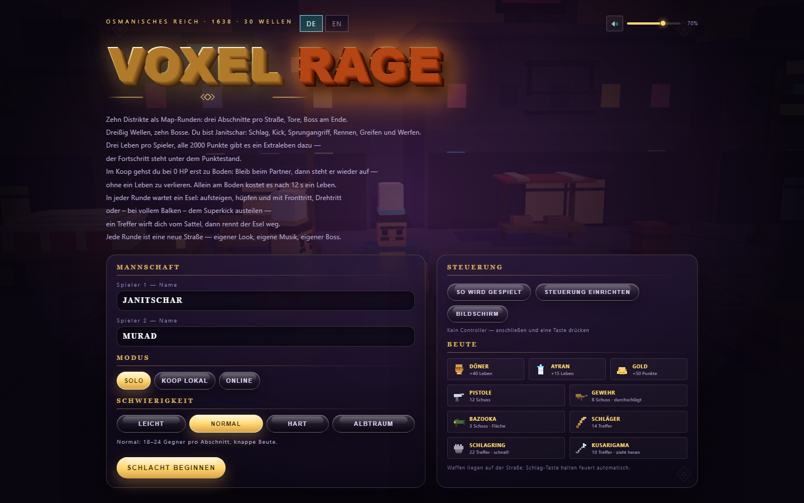
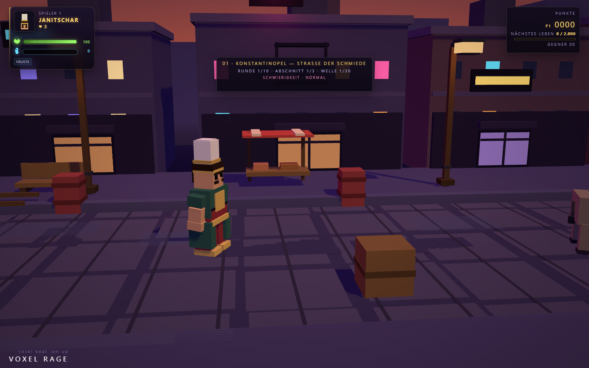
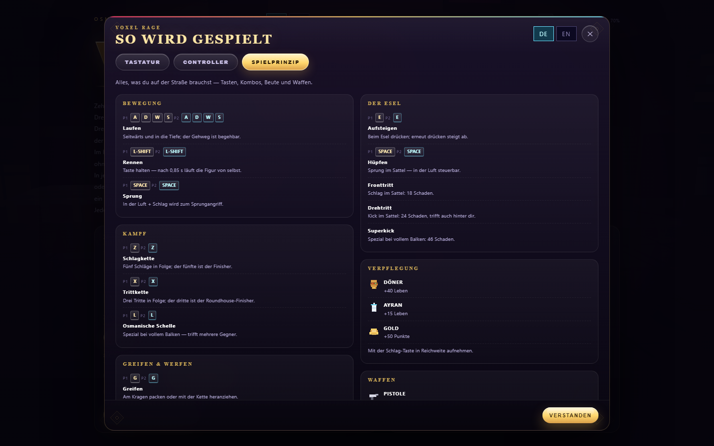
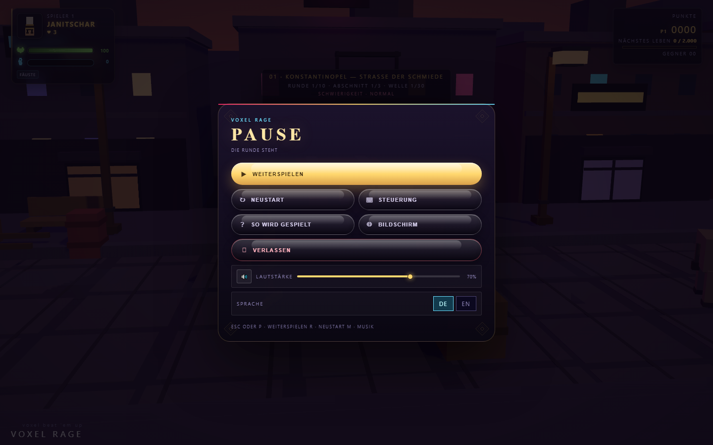
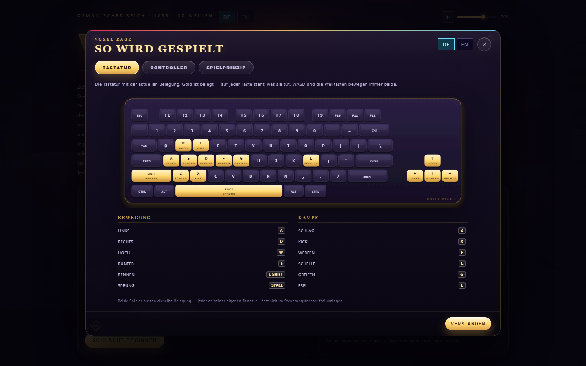
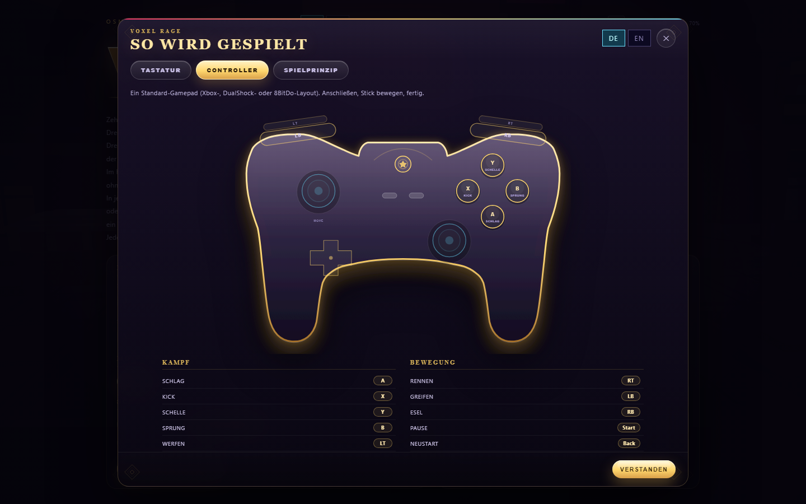
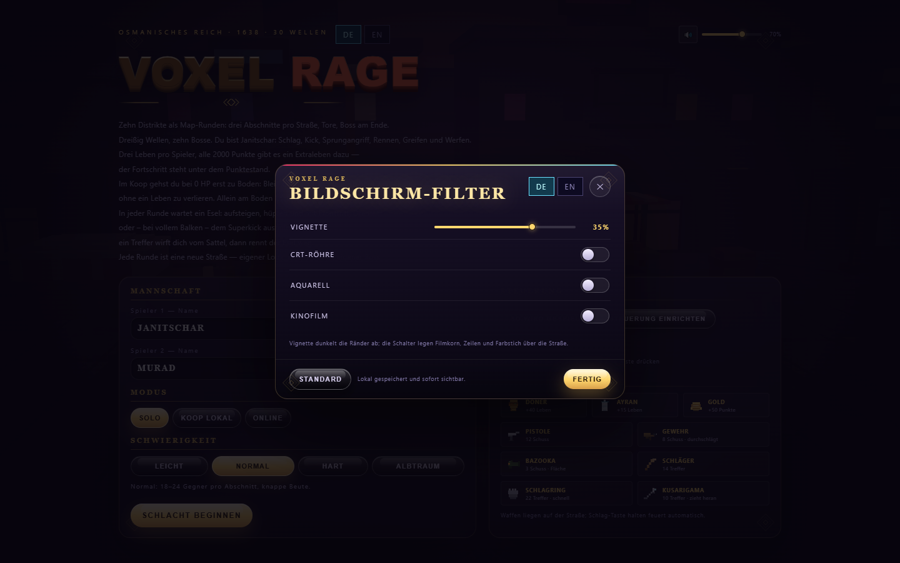
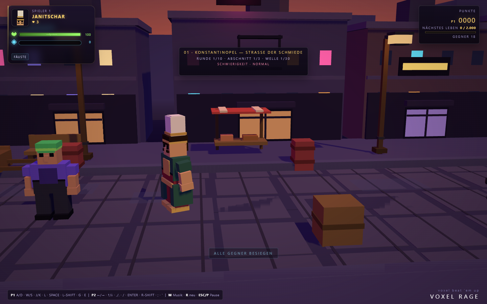

<p align="center">
  <a href="README.md"></a>
  <a href="README_DE.md"></a>
</p>

# VOXEL RAGE — Janitscharen

**Jetzt spielen: [xiondigital.net/voxelrage](https://xiondigital.net/voxelrage/)**

Ein Voxel-Beat-'em-up im osmanischen Istanbul. Jede Figur, jede Straße, jedes Gebäude und jedes Partikel besteht aus Würfeln. Dieses Repository ist die Web-Edition von [player529/Jannitschar](https://github.com/player529/Jannitschar): das Originalspiel plus gehosteter Online-Koop, Controller-Unterstützung, Sprachumschaltung im Menü, ein vollwertiges Pause-Menü, eine Spielanleitung, ein Voxel-HUD und Soundregler.

<p align="center">
  
</p>

## Was dieser Fork ergänzt

Das Spiel selbst stammt von [player529](https://github.com/player529/Jannitschar) und behält seine Bildsprache, sein Kampfgefühl und seine Inhalte. Alles Folgende kommt für die Web-Version unter xiondigital.net/voxelrage hinzu und lässt die Originaldateien unangetastet — die Web-Schicht wird beim Build angehängt.

- **Online-Koop, der wirklich verbindet.** Räume laufen über denselben Supabase-Realtime-Transport wie [Leap Buddies](https://github.com/XiONDiGiTaL/leapbuddies): eine ausgehende WebSocket-Verbindung pro Browser, Mitgliedschaft über Presence, host-autoritatives Spiel, keine Ports, keine Tunnel, kein eigener Relay.
- **Einladungslinks.** Der Raumcode des Hosts steht in der Adresszeile. „Einladungslink kopieren“ im Menü teilt eine URL, die das Spiel mit bereits eingetragenem Code öffnet.
- **Live-Verbindungsstatus.** Lobby und Pause-Menü zeigen, ob der Raum offen ist, wer beigetreten ist und ob der Relay gerade neu verbindet.
- **Saubere Ausstiege.** Verlässt der Host mitten im Lauf den Raum, bekommt der Gast eine klare Meldung und mit einem Klick den Weg zurück ins Menü statt einer eingefrorenen Straße.
- **Plug-and-play-Controller.** Gamepads mit Standardbelegung funktionieren sofort nach dem Anschließen, mit einer für Beat-'em-ups passenden Tastenbelegung.
- **Steuerungsdiagramme.** Ein leuchtendes Controller-Outline und eine vollständige 75-%-Tastatur, beide an die aktuelle Belegung gebunden: Jede belegte Taste trägt ihre Aktion, und der Pfeilblock leuchtet als zweite Bewegungsachse. Im Steuerungsfenster lassen sich Tasten und Buttons direkt anklicken und neu belegen.
- **Eine Anleitung mit Reitern.** Tastatur, Controller und Spielprinzip in einem scrollbaren Fenster, mit Voxel-Keycaps, Controller-Diagramm und Döner und Waffen als Voxel-Sprites.
- **Sprachumschaltung in den Menüs.** DE | EN sitzt im Hauptmenü und im Pause-Menü, und die gesamte Oberfläche folgt — derselbe einfache Wechsel wie in Leap Buddies.
- **Ein echtes Pause-Menü.** Weiter, Neustart, Steuerung, Anleitung, Bildschirmfilter, Sound, Sprache und Verlassen, im selben Glas-und-Gel-Stil wie der Rest der Oberfläche.
- **Bildschirmfilter.** Ein Vignette-Regler plus Schalter für CRT, Aquarell und Kinofilm, lokal gespeichert und aus Haupt- und Pause-Menü erreichbar.
- **Ein 1638-Skin.** Cinzel-Überschriften, Gel-Buttons mit Glasglanz, abgerundete Karten, osmanische Eck-Ornamente und goldene Haarlinien — dieselben Farben, nur modernisiert.
- **Eine Straße für 1638.** Planwagen mit gestreiftem Segeltuch statt Autos, Marktstände, Tonamphoren, Sandsteinbrunnen, Feigenkörbe und Holzpfosten mit Laternen, auf Kopfsteinpflaster statt bemaltern Asphalt.
- **Ein Voxel-HUD.** Ein Porträt, gerendert aus dem Kopfmodell der Figur selbst, dazu Pixelherz und EKG-Puls im Lebensbalken, der mit sinkender Gesundheit Farbe und Tempo wechselt und Richtung Flatline abflacht — plus ein Spezialbalken mit Flammensymbol, gebaut auf derselben 15-px-/186-px-Rasterung, der bei voller Ladung leuchtet.
- **Eine bequeme Belegung für beide Spieler.** Jeder Spieler — Host, Gast oder lokale zweite Tastatur — nutzt dieselben Tasten: WASD *und* die Pfeiltasten zum Bewegen, `Z` Schlag, `X` Kick, `F` Werfen, `G` Greifen, `L` Osmanische Schelle, `E` Esel, `Space` Sprung, `Shift` Rennen, `Esc` Pause. `Z` und `X` bestätigen und abbrechen außerdem in jedem Menü.
- **Soundregler und ein Menüthema.** Ein Toggle mit Lautstärkeregler in Menü und Pause-Menü steuert den Menü-Track und den Soundtrack im Spiel.

## Letzte Revision

Diese Runde hat Wortzeichen, Steuerung und Balken neu gebaut:

- **Das Wortzeichen ist wieder lila und gold — und RAGE brennt.** Ein blockiger Voxel-Riegel mit hart gestufter Extrusion: VOXEL in einem beleuchteten Goldverlauf mit weitem Glut-Halo, RAGE mit einem lebendigen Feuerverlauf in den eigenen Buchstaben. Die Flamme steigt in einer langsamen Schleife, ein Glutband flackert über die Glyphen, und einziges Ornament ist die osmanische Rauten-Haarlinie darunter.
- **Die Balken sind ein System.** Leben und Spezial teilen sich jetzt ein festes Drei-Spalten-Raster — Symbol, Balken, Zahl —, sodass Herz und neues Voxel-Flammensymbol, beide 15 px, an derselben Kante sitzen und beide Balken dieselben 186 px in derselben Höhe laufen. Die Flamme ersetzt den alten Stern und bleibt auch bei 52 px lesbar.
- **Das Gamepad ist eine echte Silhouette.** Ein breites Gehäuse, dessen Schultern zwei schmale Trigger und zwei abgerundete Bumper (LT/LB, RT/RB) tragen, eine erhöhte Brücke mit Rundtaste, ein asymmetrisches Stick-Paar, ein plusförmiges Steuerkreuz und ein Vier-Tasten-Rombus mit Aktionsbeschriftung — eine durchgehende goldene Haarlinie über einem lila Glaskörper, symmetrisch zur Mitte. Jedes gezeichnete Element lässt sich weiterhin anklicken und belegen.
- **Beide Spieler teilen eine Belegung.** WASD *und* die Pfeiltasten bewegen, `Z` Schlag, `X` Kick, `F` Werfen, `G` Greifen, `L` Osmanische Schelle, `E` Esel, `Space` Sprung, `Shift` Rennen, `Esc` Pause. Die Belegung gilt gleich für Host, Gast und Spieler 2, und das Tastatur-Diagramm lässt den Pfeilblock als zweite Bewegungsachse leuchten.
- **Menüs hören auf Z und X.** `Z` bestätigt (Schlacht starten, Pause fortsetzen), `X` bricht jedes Fenster ab — parallel zu `Esc`.
- **Die Pause ist geteilt und nennt den Verursacher.** Im Online-Koop steht die Runde für beide, und das Pause-Panel schreibt in kleinen Versalien, welche Seite pausiert hat — auch den Fall, dass du pausiert hast und dein Partner wartet.
- **Das HUD-Porträt ist gerahmt, nicht beschnitten.** Die Offscreen-Kamera lässt jetzt Rand um das Kopfmodell der Figur, sodass Turban und Kinn im 52-px-Rahmen liegen.
- **Kleine Korrekturen.** Die Tastenleiste am unteren Rand ist weg (die Anleitung übernimmt das), der Waffen-Chip ist kleiner, und der Spezial-Hinweis kollidiert nicht mehr mit dem Mittelfeld.

## Screenshots

Aufgenommen aus dem laufenden Spiel, keine Mock-ups.

### Oberfläche

| | |
|---|---|
|  |  |
| Startmenü mit Sprach- und Soundreglern | HUD: Sprite-Porträt, Herz, EKG-Leben und Spezialbalken |
|  |  |
| Spielanleitung: Spielprinzip, Keycaps und Item-Sprites | Pause-Menü mit Sound, Anleitung, Bildschirm und Sprache |
|  |  |
| Tastatur-Diagramm, Pfeile als zweite Bewegungsachse | Controller-Diagramm im Beat-'em-up-Layout |
|  |  |
| Bildschirmfilter: Vignette, CRT, Aquarell, Kinofilm | Planwagen, Marktstände und Laternen auf Kopfsteinpflaster |

### Kampf

| | |
|---|---|
|  |  |
| Straßenkampf | Bosskampf |
|  |  |
| Die Osmanische Schelle | Online-Koop |
|  |  |
| Auf dem Esel | Frühere Menüaufnahme |

Weitere Bilder liegen in [screenshots/](screenshots/).

## Online spielen

1. Öffne [xiondigital.net/voxelrage](https://xiondigital.net/voxelrage/) in zwei Browsern oder auf zwei Geräten.
2. Ein Spieler wählt **Online → Raum erstellen (Host)**. Ein vierstelliger Code erscheint, und die Seiten-URL wird zum Einladungslink.
3. Der andere Spieler drückt **Einladungslink kopieren** und öffnet ihn — oder wählt **Online**, tippt den Code ein und drückt **Beitreten**.
4. Der Host drückt **Schlacht beginnen**. Beide Spieler landen im selben Lauf.

Der Browser des Hosts rechnet die Simulation und sendet etwa zehn Snapshots pro Sekunde; der Gast sendet Eingaben und rendert. Beide Tabs müssen offen bleiben, der Host-Browser ist maßgeblich. Solo und lokaler Koop brauchen nach dem Laden keine Verbindung.

Räume sind flüchtige Supabase-Broadcast-Kanäle (`voxelrage-v1-<CODE>`) mit öffentlichem anonymem Schlüssel; es werden keine Spieldaten gespeichert. Ein Raum fasst genau einen Host und einen Gast — ein dritter Browser erhält die Meldung, dass der Raum voll ist.

## Lokal spielen

```bash
node server.js                # http://127.0.0.1:8123, nur dieser Rechner
node server.js 9000           # anderer Port
node server.js 8123 0.0.0.0   # im lokalen Netzwerk erreichbar
```

`server.js` ist der ursprüngliche, abhängigkeitsfreie Statik-Server und WebSocket-Relay. Im lokalen Netzwerk öffnen Freunde die angezeigte Adresse, wählen Online und nutzen den Raumcode. Für Internet-Spiel mit dem Original-Relay funktioniert ein Cloudflare Tunnel:

```bash
cloudflared tunnel --url http://localhost:8123
```

Die gehostete Edition braucht den Relay nicht; sie nutzt den oben beschriebenen Supabase-Transport.

## Modi und Schwierigkeit

| Modus | Spieler | Hinweise |
|---|---|---|
| Solo | 1 | Ein Janitschar, eine Tastatur. |
| Koop lokal | 2 | Gemeinsame Tastatur und gemeinsame Kamera. |
| Online | 2 | Host + Gast, host-autoritativ, Einladungslink oder Raumcode. |

Die Schwierigkeit wird vor dem Start gewählt; im Online-Spiel gilt die Auswahl des Hosts.

| Einstellung | Leicht | Normal | Hart | Albtraum |
|---|---|---|---|---|
| Gegner pro Abschnitt | 14–18 | 18–24 | 24–32 | 28–32 |
| Beute pro Abschnitt | 7 | 5 | 4 | 3 |
| Gegner-HP | 85 % | 100 % | 120 % | 135 % |
| Gegnerschaden | 75 % | 100 % | 125 % | 145 % |
| Verstärkung bei | 4 übrig | 5 übrig | 6 übrig | 8 übrig |

Albtraum markiert jeden dritten Gegner als Elite (goldene Aura, Schulterplatten, Krone, +70 % Leben) und stellt jedem Boss drei Elite-Wachen zur Seite.

## Steuerung

### Tastatur (Standard)

Beide Spieler nutzen dieselbe bequeme Belegung — jeder an seiner eigenen Tastatur. Im lokalen Koop an einer Tastatur belegt man Spieler 2 im Steuerungsfenster neu.

| Aktion | Taste |
|---|---|
| Bewegen | `W` `A` `S` `D` — die Pfeiltasten gehen immer zusätzlich |
| Schlag / Waffe / Aufnehmen | `Z` |
| Kick | `X` |
| Werfen (im Griff) | `F` |
| Spezial (Osmanische Schelle / Superkick) | `L` |
| Sprung / Esel-Hüpfer | `Space` |
| Rennen (halten) | `Shift` |
| Greifen / Kette | `G` |
| Auf-/Absteigen (Esel) | `E` |

`Z` bestätigt und `X` bricht in den Menüs ab; `Esc` oder `P` pausiert, `M` schaltet die Musik, `R` startet neu. Die Belegung wird lokal gespeichert und im Online-Koop an den Host übertragen.

### Controller (Standard)

Gamepads mit Standardbelegung: Xbox-Style, DualShock/DualSense sowie die meisten 8BitDo- und generischen Pads.

| Aktion | Taste |
|---|---|
| Bewegen | Linker Stick oder Steuerkreuz |
| Schlag / Aufnehmen / Feuern | A (unten) |
| Sprung / Esel-Hüpfer | B (rechts) |
| Kick | X (links) |
| Spezial | Y (oben) |
| Werfen (im Griff) | LT |
| Greifen / Kette | LB |
| Aufsteigen | RB |
| Rennen (halten) | RT |
| Pause | Start |
| Neustart | Back / View |

Das Pad übersetzt in die Tastenbelegung des Spiels: Eine geänderte Taste ändert auch das Pad. Jedes Pad mit Standardbelegung wird sofort übernommen — ohne Einrichtungsschritt.

### Spielanleitung

Im Startmenü sitzt eine **Spielanleitung** — dieselbe Idee wie der Feldführer in Leap Buddies. Sie öffnet ein scrollbares Popup mit drei Reitern:

- **Tastatur** — das komplette Brett, jede belegte Taste gold mit ihrem Aktionsnamen, der Pfeilblock als zweite Bewegungsachse, dazu eine Legende für Bewegung und Kampf.
- **Controller** — dasselbe Layout als Outline-Pad: Gesichtstasten, Steuerkreuz, Sticks, Bumper, Trigger und Rundtaste, jeweils mit Aktion beschriftet.
- **Spielprinzip** — Bewegung, Kombos, Greifen und Werfen, der Esel, Essen und Waffen, mit Voxel-Sprites neben jedem Pickup.

Jede Belegung im Popup ist live: Sie folgt Umbelegungen und der gewählten Sprache. Die Anleitung ist aus Hauptmenü, Pause-Menü und Steuerungsfenster erreichbar.

### Belegen

Öffne **Steuerung einrichten** im Startmenü oder **Steuerung** im Pause-Menü. Das Fenster hat zwei Reiter:

- **Controller** — ein kompaktes Outline-Gamepad mit Steuerkreuz, zwei Sticks, vier Gesichtstasten (A / B / X / Y), beiden Bumpern und beiden Triggern. Wähle rechts eine Aktion und drücke dann eine Taste am Pad — oder klicke direkt auf den gezeichneten Button.
- **Tastatur** — eine vollständige Tastatur, deren Tasten gold leuchten, wenn sie belegt sind. Wähle Spieler und Aktion und drücke dann die Taste oder klicke auf das Keycap.

Belegungen werden getauscht statt doppelt vergeben, damit keine Taste zweimal existiert. Die Pad-Belegung liegt unter `voxelrage-pad-v1`, die Tastaturbelegung unter `voxel-rage-bindings-v2`. Beides gilt nur im jeweiligen Browser.

### Bildschirmfilter

**Bildschirm** im Hauptmenü oder Pause-Menü öffnet ein kleines Fenster mit Vignette-Regler und drei Schaltern: CRT-Zeilen, Aquarell-Korn und ein Kinofilm-Look mit Balken. Die Einstellungen wirken sofort, auch mitten im Lauf, und liegen unter `voxel-rage-fx-v1`.

## Pause-Menü und Sprache

`Esc` oder `P` friert Simulation, Snapshots und Musik ein und öffnet das Pause-Menü:

- **Weiterspielen** — weiter.
- **Neustart** — Lauf zurücksetzen.
- **Steuerung** — Steuerungsfenster öffnen.
- **Bildschirm** — Vignette sowie CRT-, Aquarell- und Kinofilm-Filter.
- **Spielanleitung** — Anleitung öffnen.
- **Verlassen** — Sitzung beenden und zurück ins Menü.
- **Sound** — Lautsprecher-Toggle und Lautstärkeregler unter den Buttons.
- **Sprache** — derselbe DE | EN-Wechsel wie im Hauptmenü.

Die Pause ist geteilt. Im Online-Koop reicht der Host das Anhalten weiter, sodass beide warten, und die Zeile unter **Pause** nennt die Seite, die die Runde gestoppt hat („Spieler 2 hat pausiert — die Runde steht für beide“ oder „Du hast pausiert — der andere Spieler wartet“). `Z` oder `X` verlässt das Menü ebenfalls, neben `Esc`.

Die Sprachwahl wird unter `voxelrage-lang` gespeichert und gilt für die gesamte Oberfläche, inklusive HUD-Aktualisierungen und Statusmeldungen, nicht nur für die Menüs.

## HUD

Jede Spielerkarte ist ein Voxel-Panel mit einem kleinen Porträt der gewählten Figur — offscreen aus dem Kopfmodell der Figur gerendert, keine Zeichnung — neben Name und Leben. Darunter liegen beide Balken auf einem Raster: ein Pixelherz neben dem Lebensbalken, dessen EKG-Spur mit sinkender Gesundheit Farbe und Tempo wechselt und abflacht, und eine Voxel-Flamme neben dem Spezialbalken, der bei voller Ladung leuchtet und einen Lichtschein laufen lässt.

Der Puls im Lebensbalken ist eine scrollende EKG-Maske in der Füllung. Farbe und Tempo folgen der Gesundheit: Grün über 60 %, Gelb dazwischen, Rot unter 30 %. Sinkt sie, wird die Spur langsamer, verliert Amplitude und flacht zur Flatline ab, während das Herz langsamer schlägt; die HP-Zahl steht neben dem Balken.

Der Spezialbalken folgt demselben Raster — Flammensymbol, 186-px-Hülle, live mitlaufende Zahl — und pulsiert mit einem Lichtschein, sobald er voll ist, damit die Osmanische Schelle / der Superkick sofort ablesbar ist. Waffen erscheinen als kleiner Chip unter den Balken.

## Sound

Ein Lautsprecher-Toggle und ein Lautstärkeregler sitzen im Hauptmenü und im Pause-Menü. Sie steuern:

- das loopende Menüthema (`web/assets/menu-theme.mp3`), das nur im Startmenü läuft und beim Start eines Laufs stoppt,
- den synthetisierten Distrikt- und Boss-Soundtrack, über einen Lautstärkeparameter, den der Build in die Musik-Engine einfügt,
- und die Soundeffekte des Spiels über dessen Mute-Flag, sodass die `M`-Taste und der Menü-Toggle übereinstimmen.

Die Wahl liegt unter `voxelrage-audio-v1` und wird beim nächsten Besuch wiederhergestellt. Browser erlauben Audio meist erst nach einem Klick; die erste Interaktion schaltet das Thema frei.

## Gameplay

**Aufbau.** Zehn Distrikte mit je drei Abschnitten — 30 Wellen, jede eine 340 Einheiten lange Straße mit Tor und Boss am Ende. Jeder Distrikt hat eigenen Himmel, eigene Fassaden, eigene Musik und einen eigenen Boss.

**Kampf.** Fünfschlag-Kette und Dreitritt-Kette, jede Stufe mit eigener Silhouette und Reichweite. Schlag in der Luft ergibt einen Divekick. Die Osmanische Schelle fegt in weitem Bogen, hinterlässt Handabdrücke und füllt sich durch Treffer.

**Greifen.** Nah am Kragen packen oder mit der Kette aus bis zu 12,5 Einheiten heranziehen. Herumtragen und in Gegner oder Requisiten werfen. Bosse lassen sich nicht halten.

**Der Esel.** Einer pro Map, mit Hüpfen, Fronttritt, Drehtritt und Superkick bei vollem Balken. Jeder Treffer wirft den Reiter herunter, dann rennt der Esel weg.

**Koop-Überleben.** Bei 0 HP geht ein Koop-Spieler zu Boden statt zu sterben; bleib in der Nähe, dann rettet ihn der Rettungsbalken ohne Lebensverlust. Solo kostet 0 HP sofort ein Leben. Drei Leben pro Spieler, alle 2.000 eigenen Punkte ein Extraleben, getrennte Punktezeilen.

**Gegner.** Zehn Typen mit eigenen Ausholbewegungen, Reichweiten und Verhalten: Sprint, Block, Schild, Fernkampf, Explosion, Elite-Varianten. Über verletzten Gegnern erscheinen Lebensbalken, jeder Treffer zeigt eine Schadenszahl.

**Beute und Zerstörung.** Döner, Ayran und Gold; Pistole, Gewehr, Bazooka, Schläger, Schlagring und Kusarigama. Autos, Laternen, Bänke und Requisiten nehmen stufenweisen Schaden; zerstörte Autos lösen Alarme aus, die Gegner ablenken und Verstärkung rufen.

**Sound.** Jeder Track im Spiel wird live im Browser synthetisiert — ein Sequencer pro Distrikt und ein schnellerer Moll-Track für Bosse. Die einzige Audiodatei ist das mitgelieferte Menüthema.

## Build und Deployment

```bash
node web/build.mjs    # schreibt dist/
```

Node 20+, keine Abhängigkeiten. Der Build:

- kopiert `vendor/` und `web/assets/` (Menüthema)
- kopiert `web/net.js`, `web/i18n.js`, `web/gamepad.js` und `web/ui.js` neben das Spiel
- kopiert `content.js` mit einem geprüften Patch, der der Musik-Engine einen Lautstärkeparameter von 0–1 gibt
- fügt den supabase-js-UMD-Build und die Web-Skripte in `index.html` ein
- patcht `game.js`, damit die klassischen Steuerungen mit dem Raum-Transport sprechen, Relay-Fehler lesbare Meldungen ergeben und `window.VoxelGame` für die Web-Oberfläche bereitsteht
- bricht laut ab, wenn sich ein Anker im Upstream verschoben hat, statt einen veralteten Patch zu veröffentlichen

`.github/workflows/pages.yml` führt diesen Build bei jedem Push auf `main` aus und veröffentlicht `dist/` über GitHub Pages, das xiondigital.net/voxelrage ausliefert. `server.js`, Screenshots und `.check` landen nie in `dist/`.

## Architektur

| Datei | Inhalt |
|---|---|
| `index.html` | HUD, Startmenü, Online-Panel, CSS |
| `game.js` | Three.js-Szene, Figuren, Kampf, Wellen, Items, Host-Simulation, Menü |
| `content.js` | Distrikte, Gegner, Bosse, Waffen, Items, 30 Wellen, Musik-Sequencer |
| `server.js` | Ursprünglicher abhängigkeitsfreier Statik-Server und WebSocket-Relay |
| `vendor/three.module.js` | Three.js r160, MIT |
| `web/net.js` | Supabase-Raumtransport, Einladungslinks, Verbindungsstatus |
| `web/i18n.js` | DE/EN-DOM-Übersetzung und die Sprachschalter in den Menüs |
| `web/gamepad.js` | Controller-Abfrage, Beat-'em-up-Standardbelegung, Umbelegen |
| `web/ui.js` | Pause-Menü, Anleitung, HUD, Steuerungsdiagramme, Bildschirmfilter, Sound, Lobby-Ergänzungen |
| `web/assets/menu-theme.mp3` | Menüthema |
| `web/build.mjs` | Build- und Patch-Pipeline |
| `.github/workflows/pages.yml` | GitHub-Pages-Build und Deployment |

`window.__voxel` bleibt das Entwicklungs-Handle des Spiels. Die Web-Schicht nutzt die kleinere Brücke `window.VoxelGame` (Belegungen, Net-Status, Pause-Helfer), die der Build anhängt.

## Einschränkungen

- Online-Koop ist host-autoritativ für zwei Spieler. Der Gast interpoliert Host-Positionen aus etwa zehn Snapshots pro Sekunde; es gibt keine Prädiktion. Der Browser des Hosts muss für die Sitzung offen bleiben.
- Ein Raum fasst einen Host und einen Gast. Es gibt keine Lobby-Liste und kein Matchmaking über Code oder Link hinaus.
- Distrikte sind prozedurale Variationen einer Straße mit eigenen Paletten, Landmarken und Requisiten, keine zehn von Hand modellierten Level.
- Der Esel ist ein Versuch pro Map; sobald der Reiter heruntergeworfen wird, rennt er weg.
- Die Steuerungsdiagramme sind SVG, brauchen also kein WebGL und bleiben auf jedem Gerät lesbar.
- Musik und Effekte werden in Echtzeit synthetisiert, der Mix hängt also vom Browser ab; das Menüthema ist eine mitgelieferte Audiodatei und braucht eventuell einen Klick, bevor der Browser sie abspielt.
- Das HUD liest den lokalen Simulationszustand; im Online-Koop spiegelt die Gesundheitskarte des Gasts die Snapshots des Hosts.

## Danksagung

Originalspiel, Design und Bildsprache: [player529](https://github.com/player529/Jannitschar) — *Janitscharen / Voxel Rage*. Dieser Fork bewahrt diese Vision und ergänzt Web-Hosting, Online-Transport, Controller-Unterstützung und Oberflächenarbeit. Three.js steht unter MIT-Lizenz; siehe `vendor/three.module.js`.

Menüthema: *Voxel Rage (Main Menu)*, für diesen Fork als `web/assets/menu-theme.mp3` mitgeliefert.
